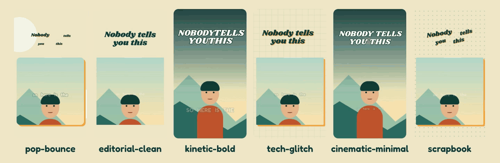
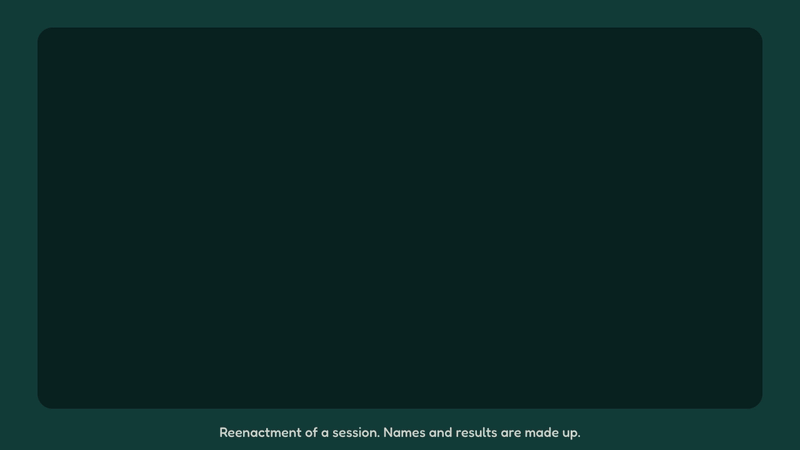
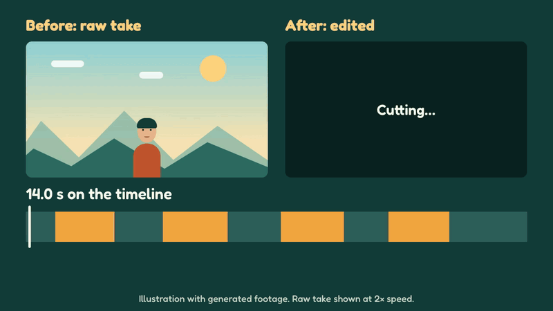
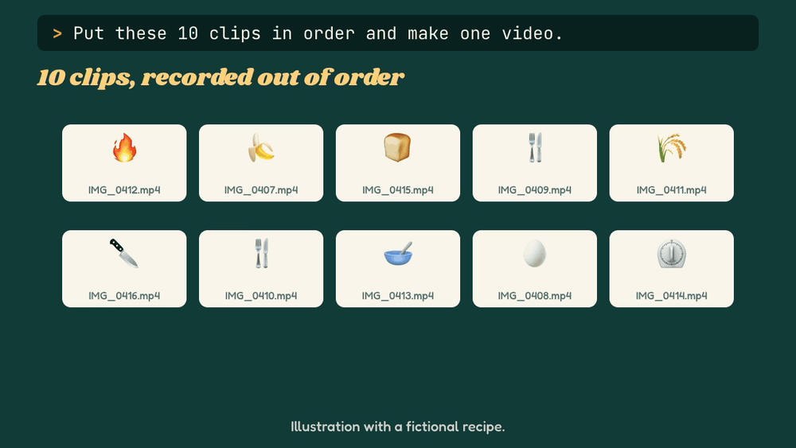
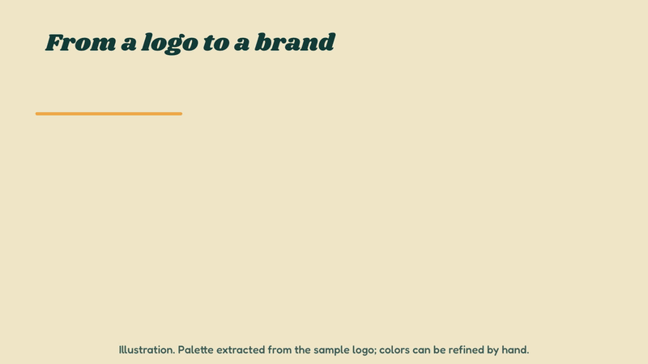
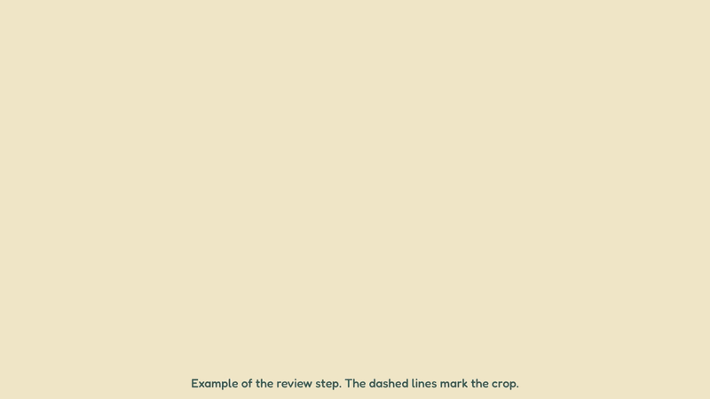
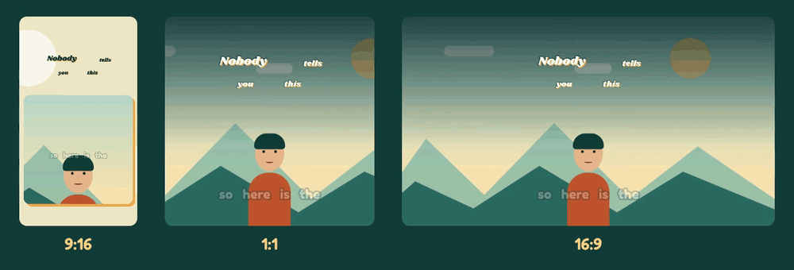

# Brand Video Studio

[](https://github.com/sponsors/CarlosSantana94)

A skill for [Claude Code](https://claude.com/claude-code) that turns long videos into branded reels, or edits raw footage to hold attention, all from a conversation.

You give it a video and a logo. Claude watches the footage, proposes the reels, builds them as code and reviews each render before handing it over.


```text
> Make 8 reels from podcast.mp4 for my coffee brand. The logo is in ./brand.
> Tighten this raw tutorial and add captions. Keep it horizontal.
> Show me animation styles for a real estate agency.
```

## What it does

- **Builds a brand guide** from your logos, photos and references, or proposes one if you have none.
- **Creates X reels from one long video:** finds the moments, writes the hooks, cuts on word boundaries and covers weak shots with b-roll.
- **Works with many videos:** puts clips recorded in pieces in order, or plans a batch of reels across all your footage.
- **Edits raw footage:** removes dead air and fillers, then adds jump zooms, captions, punch-ins and animated layers.
- **Offers six animation styles,** plus a catalog of parts for making your own.
- **Reviews its own work** by watching the render against a checklist of real failures.
- **Writes the copy** and a posting calendar, in your language.

It works in any language and outputs 9:16, 16:9 or 1:1.

| Style | Feels like | Good for |
|---|---|---|
| `pop-bounce` | Playful, elastic, hard shadows | Travel, lifestyle, food |
| `editorial-clean` | Quiet, flat, slow | Premium brands, health, consulting |
| `kinetic-bold` | Huge type, fast cuts | Education, opinion, podcasts |
| `tech-glitch` | Grid, stepped motion | Software, AI, gaming |
| `cinematic-minimal` | Full-bleed, long fades | Documentary, real estate, weddings |
| `scrapbook` | Tilted, paper, warm | Family, DIY, recipes |



## See it in action

These demos use generated footage and a fictional brand. The styles and formats were rendered with the skill's own scripts; the other clips illustrate the process.

### Start from a conversation

Reenactment of a session. The names and results are made up.



### Edit raw footage

A 14-second take drops to 6.9 seconds once `autocut.py` removes dead air and fillers. Captions, a hook and a stat card go on top.



### Turn many clips into one video

Recorded a recipe in ten pieces? Claude watches every clip, finds the retakes, and proposes an order based on what happens in them. Once you approve, it cuts the dead air, evens out the volume and adds the captions and step labels. It also plans batches, such as 20 reels from 15 videos, and can pick up where it stopped.



### Build a brand from a logo

`extract_palette.py` reads the colors from your files. You or Claude then assign their roles in `brand.json`, and every video follows it.



### Review every render

Claude watches the finished video and fixes what it finds. This example shows a title that falls outside the cover crop.



### Export for every platform



## How it works

1. [claude-eyes](https://github.com/moritzkremb/claude-eyes) gives Claude evidence of what is in the video: shots, on-screen text and word timings.
2. Your brand lives in `brand.json`, and each video is a `cut.json` and a `spec.json`.
3. Scripts assemble them into [HyperFrames](https://www.npmjs.com/package/hyperframes) compositions, which render HTML to video frame by frame.
4. Claude checks the render with claude-eyes and fixes what it finds.

## Install

You need [Claude Code](https://claude.com/claude-code), Python 3, Node.js 22 or newer, ffmpeg and claude-eyes.

```bash
git clone https://github.com/CarlosSantana94/brand-video-studio.git
cd brand-video-studio
./install.sh
```

`install.sh` links the skill into `~/.claude/skills`, so it works in every project, and lists anything missing.

To install claude-eyes:

```bash
uv tool install git+https://github.com/moritzkremb/claude-eyes
eyes setup --fix
```

The `hyperframes` and `eyes` skills are recommended too, since they add detail about both tools.

### Windows

Tested on Windows 11. In PowerShell, install the tools first, then open a new terminal so it picks up the new `PATH`:

```powershell
winget install Python.Python.3.12
winget install OpenJS.NodeJS.22
winget install Gyan.FFmpeg
winget install astral-sh.uv
```

Then install the skill and claude-eyes:

```powershell
git clone https://github.com/CarlosSantana94/brand-video-studio.git
cd brand-video-studio
powershell -ExecutionPolicy Bypass -File install.ps1
uv tool install git+https://github.com/moritzkremb/claude-eyes
eyes setup --fix
eyes install-skill
```

`install.ps1` links the skill with a junction, which needs neither admin rights nor Developer Mode. `./install.sh` does the same from Git Bash.

Two things differ from macOS and Linux:

- **whisper.cpp is a manual step.** `eyes setup --fix` cannot install it on Windows, and without it videos get no local transcript. Download `whisper-bin-x64.zip` from the [whisper.cpp releases](https://github.com/ggml-org/whisper.cpp/releases) (not every release includes it, so take the newest that does), unzip it, add that folder to your `PATH`, then run `eyes setup --download-model large-v3-turbo-q5_0`. The model is about 570 MB.
- **Use `python`, not `python3`.** On Windows `python3` is usually a Microsoft Store stub. The skill knows this, but you will need it for running a script by hand.

## Use it

Open Claude Code in a folder with your video and describe what you want. The skill loads on its own. A reel project looks like this:

```text
my-brand/
  brand/        brand.json, BRAND.md, logo and fonts
  source/       word timings of the long video
  videos/       one folder per video, with cut.json and spec.json
  renders/      final MP4s
  COPY.md       titles, captions and hashtags
```

See [`examples/`](examples/) for a sample brand and video spec.

## Make it yours

- **Brand sounds:** set `sfx_dir` in `brand.json`. Files named like the built-in effects replace them.
- **New styles:** copy a preset in [`skill/assets/styles.json`](skill/assets/styles.json).
- **Rules:** add what you learn to your project's `BRAND.md`, or to [`skill/references/review-checklist.md`](skill/references/review-checklist.md).

## Good to know

- Rendering happens on your computer. A 30-second reel takes a few minutes.
- `eyes` transcribes locally, so your footage stays on your machine by default.
- You are responsible for the rights to your footage, music and fonts. Platforms may mute commercial music.
- Scheduling limits and posting rules change. Check them on each platform.

## Credits

Built on [HyperFrames](https://www.npmjs.com/package/hyperframes), [GSAP](https://gsap.com) and [claude-eyes](https://github.com/moritzkremb/claude-eyes). Sound effects are generated by `skill/scripts/make_sfx.py`. Check the license of each dependency for your use, especially commercial use.

Bundled fonts: Fredoka and Shrikhand, under the [SIL Open Font License](skill/assets/fonts). Everything else is [MIT](LICENSE).

## Support the project

The skill is free and open source. If it saves you editing time, you can [sponsor its development on GitHub](https://github.com/sponsors/CarlosSantana94).
