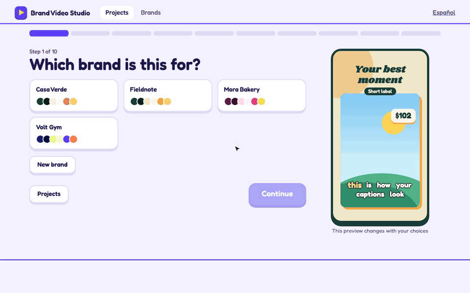
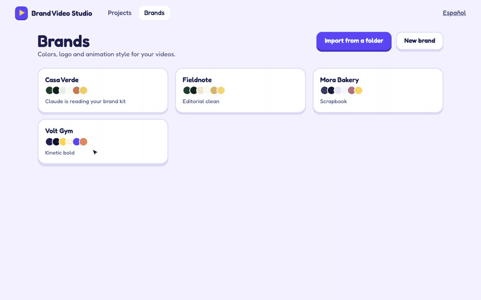
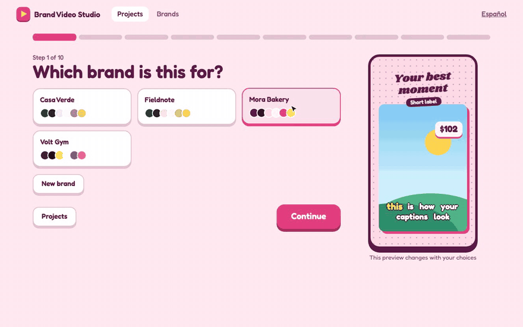
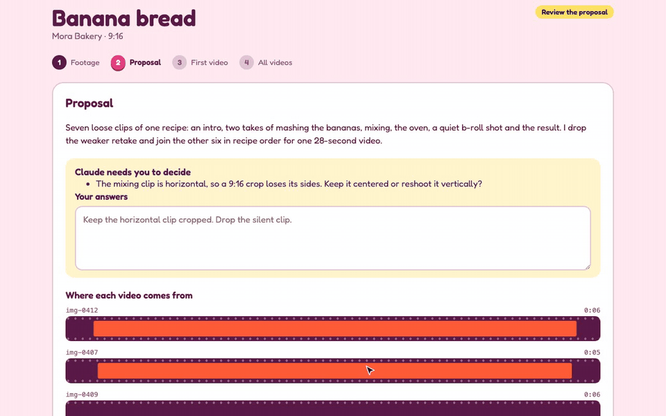
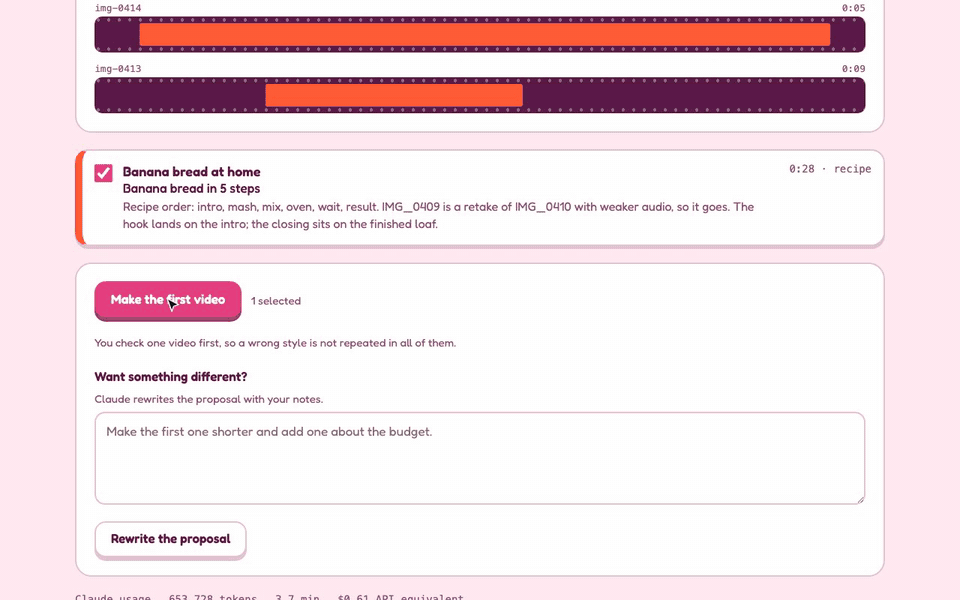

# Brand Video Studio app

A local app for the [Brand Video Studio](../README.md) skill. Pick a brand, point it at the videos you recorded, answer a few questions, and Claude Code edits them into branded videos while you watch.



```bash
git clone https://github.com/CarlosSantana94/brand-video-studio
cd brand-video-studio
python3 app/server.py
```

It opens at `http://127.0.0.1:4410`. You need Python 3.10 or newer, the tools from [Install](../README.md#install), and [Claude Code](https://claude.com/claude-code) installed and signed in.

These demos use a fictional brand and generated footage.

## Bring your brand kit

Point the app at the folder with your brand guidelines, logos and fonts. Claude reads the whole kit, the finished pieces too, and writes the brand: its colors mapped to video roles, its fonts, its logo, its graphic elements, and a guide to its visual rules that every video follows. You can still edit everything afterwards.

No kit? Create the brand by hand: name, logo, colors from the logo, animation style and voice.



## Say what you want, one question at a time

Ten short steps, with a phone beside you that changes as you choose:

- **Videos:** a folder on your computer, used where it is, or files you pick.
- **Context:** several reels or one video, and what it is for, in your own words.
- **Style:** six animation styles, from playful to cinematic.
- **Motion graphics:** none, a little, some or a lot.
- **Captions:** on or off, colored word or boxed word, size and capitals.
- **Expressiveness, count and length.**
- **Platforms and formats:** 9:16, 16:9 and 1:1.
- **Sound:** your own folders of sound effects and music.



## Approve the plan before anything is cut

Claude watches every clip, then proposes the videos: which moments, in what order, and which retakes it drops. The strip shows the part of each clip it will use. When it needs a decision, it asks, and you answer in the same place.



## Watch it work, then review

The log shows what Claude is doing as it happens. The first video comes back for you to check before it makes the rest, so a wrong caption size is caught once, not twenty times. Ask for a change in plain words, download the files, and copy the titles and captions for each platform.



## How it works

- **Runs on your computer.** A small Python server, no dependencies, bound to `127.0.0.1`. Your footage never leaves your machine.
- **Uses your Claude Code.** Each job runs the unmodified `claude` command with the skill, signed in with your own account. The app never sees your Claude credentials and has no accounts of its own.
- **The app does the plain work.** It watches and transcribes every clip with `eyes` and makes a contact sheet per clip before Claude starts, so Claude spends its effort on choosing and editing.
- **One job at a time.** Renders are heavy, and your plan's limits are shared. If you hit a limit, the job pauses and you continue when it resets. Stopped jobs resume where they were, including a change you asked for.
- **Checks the result.** A job only counts as done when it produced a new render.
- **Your data:** brands and projects live in `~/BrandVideoStudio`, or the folder in `BVS_HOME`. Footage from a folder is linked, not copied.

| Variable | Default | Use |
|---|---|---|
| `BVS_HOME` | `~/BrandVideoStudio` | Where brands and projects are kept |
| `BVS_CLAUDE` | `claude` on your `PATH` | Another Claude Code binary |

Start it on another port with `python3 app/server.py --port 4411`, or without opening the browser with `--no-open`.

## Cost and time

Every project shows its Claude usage and an API-equivalent cost. With a Claude plan, that usage counts toward your plan's limits instead of being billed. In our tests:

- Reading a brand kit: about 1 USD and 5 minutes.
- A 75-second recipe video from 20 clips (about 20 minutes of footage): about 4 USD per pass and 20 to 30 minutes, most of it rendering.

Long footage, many videos and change requests add up. Check the first video before making the rest.

## Good to know

- **Commands run without asking.** Claude may use Python, ffmpeg, npx, `eyes` and file tools inside the project, so only use footage you trust.
- **Review what you post.** Claude reviews every render against a checklist, but it can miss things. Watch each video before publishing.
- **Rights:** you are responsible for the rights to your footage, music and fonts.
- **Licenses:** the app renders with [HyperFrames](https://www.npmjs.com/package/hyperframes) and [GSAP](https://gsap.com). Check their licenses before offering the app to others, especially as a hosted or commercial tool.

## Development

```bash
python3 -m unittest discover -s app/tests
```

The tests use a fake Claude (`app/tests/fake_claude.py`), so they run offline and spend nothing. The interface is plain HTML, CSS and JavaScript in `app/web`, with no build step, in English and Spanish.
